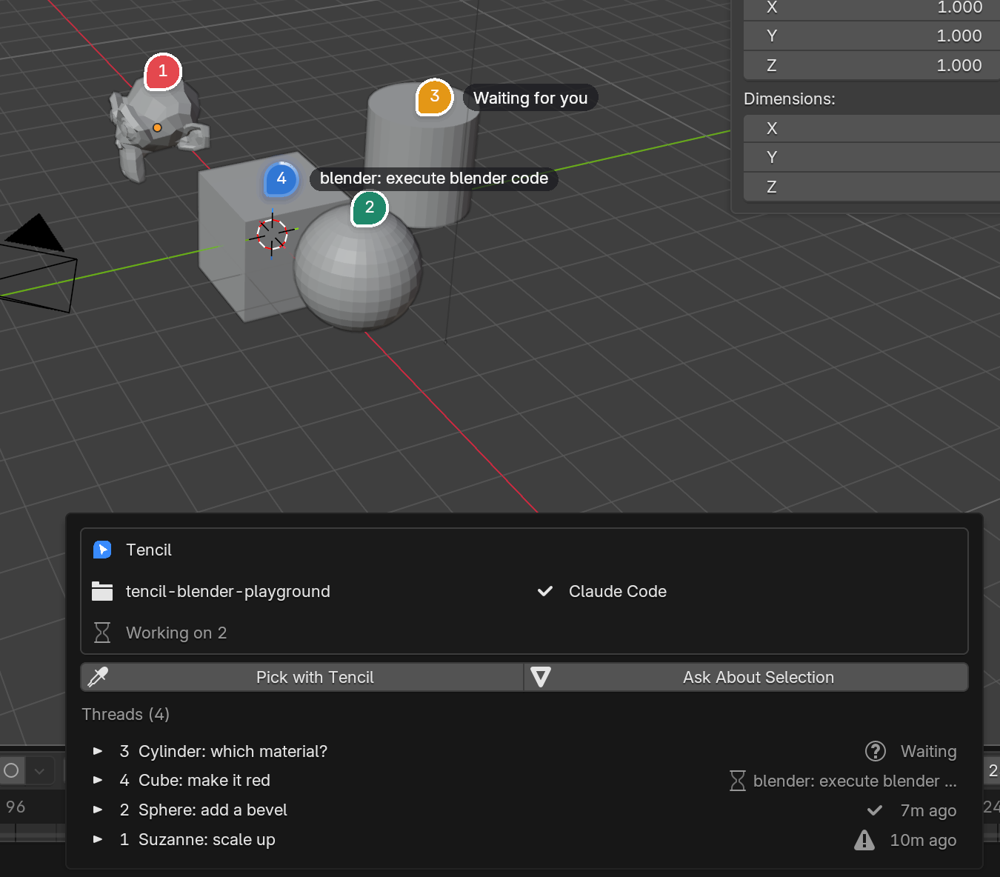

# Tencil for Blender (experiment)

Point at an object in Blender, say what should change, and your coding agent does it
in the open scene. It's [Tencil](https://github.com/tencildev/tencil)'s pin-and-prompt
flow, with Blender as the client. Tencil itself knows nothing about Blender: the add-on
talks to the normal Tencil daemon, and the agent changes the scene through
[Blender Lab's MCP server](https://www.blender.org/lab/mcp-server/).



```
Blender ── Tencil add-on ──ws──▶ tencil daemon ──▶ agent (Claude Code)
   ▲                                                    │
   └──── Blender MCP add-on ◀──tcp── blender-mcp ◀─stdio─┘
```

## Setup

The quickest way: paste [docs/setup-prompt.md](docs/setup-prompt.md) into your coding
agent from the folder your `.blend` files live in. By hand:

You need Blender 5.1 or newer (for Blender Lab's MCP add-on),
[Claude Code](https://docs.claude.com/en/docs/claude-code) installed and logged in,
[uv](https://docs.astral.sh/uv/) (`uvx` starts Blender's MCP server) and Node 22+.

1. **Start Tencil:** `npx --yes tencil@latest setup` (starts it at login) or
   `npx --yes tencil@latest start`.
2. **Install the add-on:** download `tencil-<version>.zip` from the
   [latest release](https://github.com/tencildev/tencil-blender/releases/latest) and
   drag it into Blender, or
   `blender --command extension install-file -r user_default -e tencil-<version>.zip`.
3. **Install Blender Lab's MCP add-on:** Preferences ▸ Get Extensions ▸ Repositories ▸
   **+** ▸ Add Remote Repository, `https://lab.blender.org/`, then install **MCP**.
   In its preferences turn on **Auto Start**, and turn on **Preferences ▸ System ▸
   Allow Online Access** (without it the add-on won't open its local socket).
4. **Connect the project:** save your `.blend` inside the project folder (a git
   repository, or any folder). Open the **Tencil** tab in the 3D view's sidebar (N) and
   click **Add Blender MCP to .mcp.json**. If it says the agent can't use Blender's
   tools, click **Use Claude Code**: T3 Code's default agent, Codex, doesn't read
   `.mcp.json`.

## Using it

- **Alt+T** (or **Pick with Tencil**) picks: hover outlines the object under the cursor,
  click asks about it, Shift-click picks several and Enter asks about all of them.
  Cameras, lights and empties are hit near their origin.
- Or select objects as usual and use **Object ▸ Ask Tencil** or the right-click menu.

Pins show up on the objects like Tencil's pins in the browser: blue while the agent
works (with a light running round the edge and what it's doing next to it), amber when
it waits for you, green when it's done, red when it failed. The **Tencil** button in the
3D view's header (or **Alt+Shift+T**) opens the Tencil panel: every thread in the
project, what's working on top; open one for the whole conversation, the agent's steps,
and Reply / Stop / Resolve / Show / Open in agent / Delete. While the agent works, its
current step also shows in the status bar and in the sidebar's Tencil tab.

## How it works

- `ws.py` is a standard-library WebSocket client (extensions can't pip-install);
  `client.py` runs it on a thread and a Blender timer hands messages to the main thread.
- The project is the git repository the file is in (or its folder). The add-on sends it
  as `root` in its hello; Tencil 0.8 takes a git checkout from there. For other folders,
  and older daemons, the daemon asks and the add-on answers with `project.select`.
- The daemon knows the file as `ws://<project>-<hash>.blender.invalid/<path>`: a
  made-up origin per project, because it remembers projects per origin and `blender://`
  or `file://` URLs all share one ("null"). An unsaved file can't have pins: save it in
  the project first.
- Tencil's wire format describes DOM elements, so the object goes into those fields
  (`context.py`): the data path (`bpy.data.objects["Cube"]`) as the selector, and a
  description (transforms, modifiers, materials, picked point, instructions to use the
  Blender MCP tools) where the HTML would go. A viewport screenshot is attached.
- The live steps (what the agent is doing) come from the provider. Claude Code reports
  them from a Tencil build with tool-call steps; without them the pin just says
  "Working…".

## Limits (it's an experiment)

- The daemon's prompt still opens with "an element of their running app… locate the
  code"; the description corrects it. A generic, app-described context kind in Tencil's
  protocol would fix it.
- That made-up page address shows up in the agent's prompt as the "Page".
- Pins only know their object by name: renaming the object detaches the pin.
- Where on the object a pin was clicked lives in memory; after a restart pins sit on
  top of their object.
- The Tencil panel is a popover, so it closes when the mouse leaves it; the sidebar's
  Tencil tab stays open.
- Tested on macOS with Blender 5.2.
- Blender's MCP server runs agent-written Python with no safeguards. Work on files you
  can afford to lose, or in a VM.

## Development

Symlink `tencil/` into Blender's extensions folder
(`~/Library/Application Support/Blender/<version>/extensions/user_default/` on macOS)
and restart Blender. `mkdir -p dist && blender --command extension build --source-dir tencil --output-dir dist`
builds the zip.

`tests/integration.sh` runs the add-on headless against a real daemon from a Tencil
checkout (`TENCIL_REPO`, default `../tencil`, built) and its fake T3 Code: connect,
project resolution, the agent check, a pin on the default cube, the agent's reply,
reconnect, resolve.
